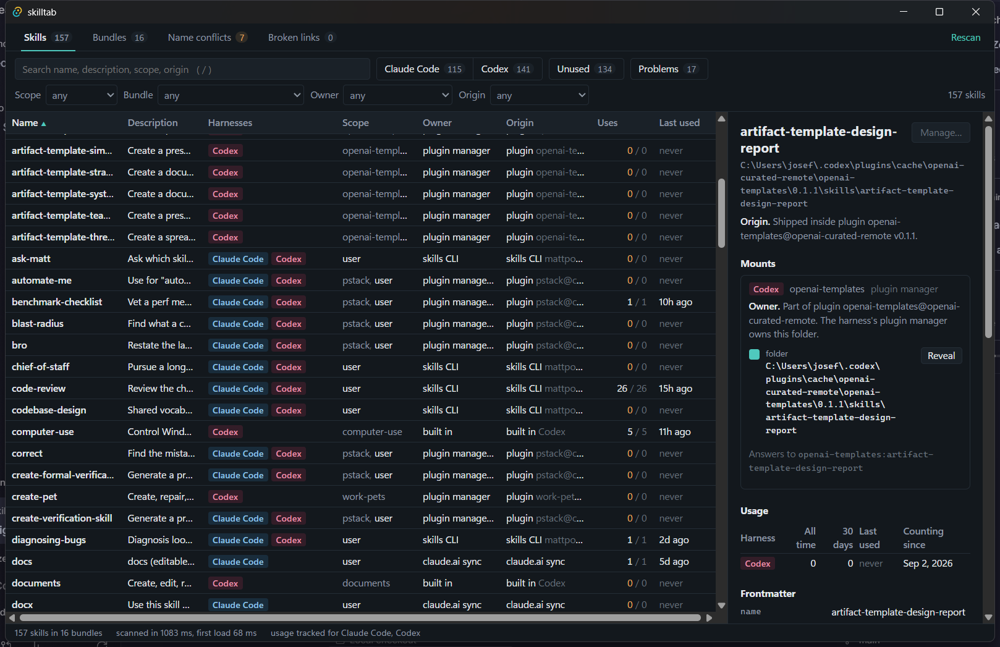

# skilltab

skilltab is a Windows desktop app that lists every agent skill on your machine in one table, for every harness that has one. Claude Code and Codex are supported today. For each skill it shows where each harness loads it from, who put it there, how often you use it, and whether it came from your jstack repo. You can disable, restore, remove, or delete a skill. Every change opens a plan first and runs only after you confirm.



## What it shows

- **One row per skill folder.** A skill that three junctions reach is one row, with each harness's path down to the real folder listed under it.
- **Scope.** User, project, or plugin bundle.
- **Owner and origin.** The owner is the tool that made the entry (a plugin manager, the `skills` CLI, jstack's sync, claude.ai sync, or you by hand). The origin is where the files came from.
- **Usage.** Counts from Claude Code and Codex transcripts, by kind: slash command, model call, `$name` mention, or a read of the skill's SKILL.md file. A skill counts as unused only for the period skilltab has transcripts for.
- **Usage history under old names.** When a transcript names a skill that is no longer installed, for example `mattpocock-skills:tdd`, skilltab suggests linking that history to the installed skill with the same name. Nothing is linked until you click **Confirm**, and **Undo** splits it off again.
- **jstack.** Which skills come from your clone, which have drifted, which a harness lacks, and the **Pull**, **Sync**, and **Install** commands from jstack's own scripts. skilltab never pushes and never edits `exclude.txt` or `~/.jstack-links.txt`.
- **Problems.** Broken links, two skills that share a name, and shadowed entries.

## What a change does

| Action | Result |
| --- | --- |
| Disable | Moves the entry to skilltab's shelf. Restore puts it back where it was. |
| Remove | Takes the skill out of one harness. A junction is unlinked and never sent to the Recycle Bin. |
| Delete everywhere | Removes every link and sends the real folder to the Recycle Bin. |
| Enable or disable plugin | Runs `claude plugin enable` or `claude plugin disable`. Codex has no such command, so the plan says it is unsupported. |

A plan is refused with a reason and a remedy in these cases:

- jstack's sync would recreate the link at the next session start. The remedy is to add the name to `jstack/exclude.txt`.
- The skill is part of a plugin. The remedy is to disable the whole plugin.
- Another harness still reaches the folder through a link.
- The folder is inside your jstack clone.
- The skill ships with the harness.

If the disk changed after the plan was made, apply refuses it and the dialog plans again.

## Run it

You need Rust (stable, MSVC), Node 24, and pnpm.

```powershell
pnpm install
pnpm tauri dev      # development window
pnpm tauri build    # installers under target\release\bundle\
```

skilltab keeps its usage index and shelf in `%LOCALAPPDATA%\skilltab`. Two environment variables point it elsewhere:

- `SKILLTAB_HOME` points the whole app at another home folder, with its data in `<home>\.skilltab-data`. `scripts\fixture-home.ps1` builds a fixture home to try changes on.
- `SKILLTAB_DATA` moves only the data folder.

jstack's `sync-skills.ps1` always writes to your real home, even when `SKILLTAB_HOME` is set.

## Test it

```powershell
cargo test -p skilltab-core                    # unit and integration tests on temp trees with real junctions
cargo test -p skilltab-core -- --ignored       # also sends one temp folder to the real Recycle Bin
cargo run -p skilltab-core --example dump      # print what the scanner finds on this machine
cargo run -p skilltab-core --example usage -- --db <scratch.db>
```

## Layout

- `crates/core` is the library with every rule. It has no Tauri dependency.
- `src-tauri` is the app shell: commands, one event, and the window.
- `src` is the React UI. It renders what the core sends. `src/bindings.ts` is generated by tauri-specta when the app runs in debug.
- `docs/design` holds the design the code follows and why it was chosen.

## Add a harness

1. Add `crates/core/src/harness/<name>.rs` that implements the `Harness` trait: where its skills live, how it names them, and how its transcript lines read.
2. Add one line to the registry in `crates/core/src/harness/mod.rs`.

Nothing else matches on a harness id. The UI reads harness names from the inventory.
