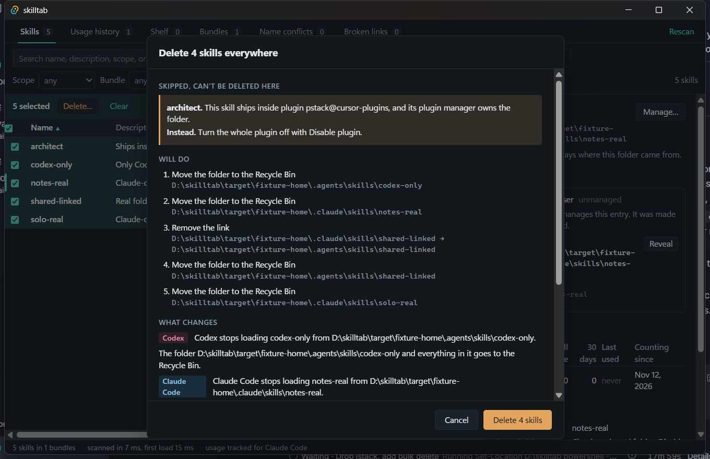
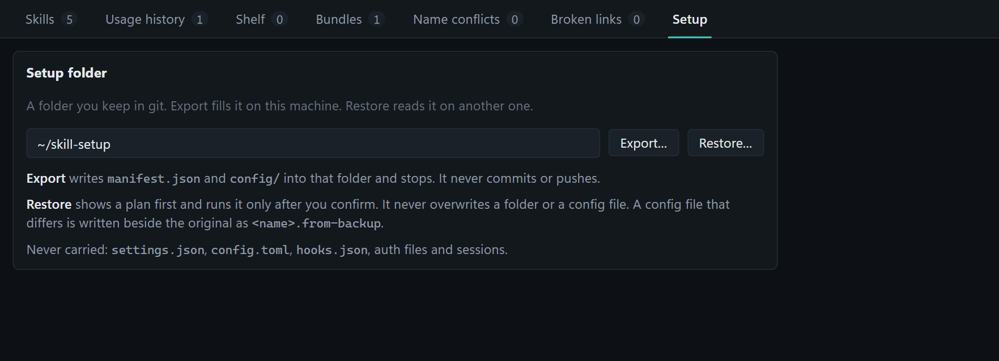
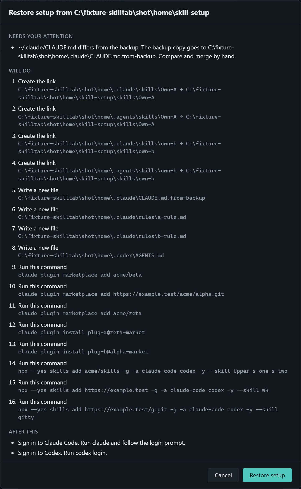

# skilltab

skilltab is a desktop app for Windows, Linux and macOS. It lists every agent skill on your machine in one table, for every harness that has one. Claude Code and Codex are supported today. For each skill it shows where each harness loads it from, who put it there, how often you use it, and which plugin or install record it came from. You can disable, restore, remove, or delete a skill. You can also export your setup to a folder and restore it on a new machine. Every change opens a plan first and runs only after you confirm.



## What it shows

- **One row per skill folder.** A skill that three links reach is one row, with each harness's path down to the real folder listed under it.
- **Scope.** User, project, or plugin bundle.
- **Owner and origin.** The owner is the tool that made the entry (a plugin manager, the `skills` CLI, claude.ai sync, or you by hand). The origin is where the files came from.
- **Usage.** Counts from Claude Code and Codex transcripts, by kind: slash command, model call, `$name` mention, or a read of the skill's SKILL.md file. A skill counts as unused only for the period skilltab has transcripts for.
- **Usage history under old names.** When a transcript names a skill that is no longer installed, for example `mattpocock-skills:tdd`, skilltab suggests linking that history to the installed skill with the same name. Nothing is linked until you click **Confirm**, and **Undo** splits it off again.
- **Problems.** Broken links, two skills that share a name, and shadowed entries.
- **Setup.** One tab exports the skills, plugins and config you carry to a folder, and restores them on another machine. See [Move to a new machine](#move-to-a-new-machine).

## What a change does

| Action | Result |
| --- | --- |
| Disable | Moves the entry to skilltab's shelf. Restore puts it back where it was. |
| Remove | Takes the skill out of one harness. A link is unlinked and never sent to the Recycle Bin or Trash. |
| Delete everywhere | Removes every link and sends the real folder to the Recycle Bin (Windows) or Trash (Linux and macOS). |
| Delete several | Tick skills in the table and choose Delete…. One plan covers all of them. A skill that is part of a plugin, ships with the harness, or is rewritten by claude.ai sync is listed as skipped, and the rest go ahead. |
| Enable or disable plugin | Runs `claude plugin enable` or `claude plugin disable`. Codex has no such command, so the plan says it is unsupported. |
| Export setup | Writes `manifest.json` and the carried config files into a folder you name, and deletes copies of files that left this machine. It never commits or pushes. It is blocked when a carried file looks like it holds a secret. |
| Restore setup | Links your own skills, copies config files, then runs the plugin and skill install commands that are missing. A folder, link or config file that is already there is never replaced. |

A plan is refused with a reason and a remedy in these cases:

- The skill is part of a plugin. The remedy is to disable the whole plugin.
- Another harness still reaches the folder through a link.
- The skill ships with the harness.

If the disk changed after the plan was made, apply refuses it and the dialog plans again.

## Move to a new machine

skilltab gets your skills back on a new Windows, Linux or macOS machine with one clone and one Restore. It does not sync anything between harnesses.



1. **Old machine.** Open the Setup tab, type a folder such as `~/skill-setup`, and choose Export…. Review the plan and confirm.
2. **Commit by hand.** The folder is plain files. Put it in a git repo, then commit and push it yourself. skilltab never does.
3. **New machine.** Install skilltab and the harness CLIs you use (Claude Code, Node.js for `npx`, Codex). Clone the repo.
4. **Restore.** Open the Setup tab, type the clone's folder, and choose Restore…. Read the plan, then confirm.
5. **Sign in.** The plan ends with the sign-in steps for each harness. skilltab does not sign in for you.



What the manifest holds:

- Claude Code plugin marketplaces and plugins.
- The skills each `skills` CLI source installed, by name.
- Your own skill folders, kept under `skills/` in the setup folder.

`config/` holds `CLAUDE.md` and `rules/*.md` for Claude Code and `AGENTS.md` for Codex.

Never carried: `settings.json`, `config.toml`, `hooks.json`, auth files and sessions. Export refuses a carried file that looks like it holds a secret.

What Restore will not overwrite:

- A real folder or a link that points elsewhere where one of your skills should be linked.
- A config file that differs from the backup. The backup copy goes beside it as `<name>.from-backup`, and the plan says to merge by hand.

Restore is safe to run again. Once everything is in place the plan reads "Nothing to change" and lists what is already present. If `claude` or `npx` is missing, the plan is blocked and says where to get it.

The format is plain JSON and is documented in [docs/design/setup-manifest.md](docs/design/setup-manifest.md).

## Run it

You need Rust (stable), Node 24, and pnpm. On Linux, install the Tauri build packages first: `libwebkit2gtk-4.1-dev`, `libgtk-3-dev`, `librsvg2-dev` and `libayatana-appindicator3-dev`.

```sh
pnpm install
pnpm tauri dev      # development window
pnpm tauri build    # installers under target/release/bundle/
```

skilltab keeps its usage index and shelf in its data folder, which is Tauri's local data directory plus `skilltab`:

| OS | Data folder |
| --- | --- |
| Windows | `%LOCALAPPDATA%\skilltab` |
| Linux | `~/.local/share/skilltab` |
| macOS | `~/Library/Application Support/skilltab` |

Two environment variables point it elsewhere:

- `SKILLTAB_HOME` points the whole app at another home folder, with its data in `<home>/.skilltab-data`. `scripts\fixture-home.ps1` builds a fixture home to try changes on.
- `SKILLTAB_DATA` moves only the data folder.

The scripts under `scripts\` are Windows PowerShell dev helpers. The app and the core do not need them.

## Test it

```sh
cargo test -p skilltab-core                    # unit and integration tests on temp trees with real links
cargo test -p skilltab-core -- --ignored       # also sends one temp folder to the real Recycle Bin or Trash
cargo run -p skilltab-core --example dump      # print what the scanner finds on this machine
cargo run -p skilltab-core --example usage -- --db <scratch.db>
```

The tests make links with the same code the app uses, so they need no junction or symlink rights. CI runs the core tests, clippy, and the app build on Windows, Linux and macOS.

## Layout

- `crates/core` is the library with every rule. It has no Tauri dependency.
- `src-tauri` is the app shell: commands, one event, and the window.
- `src` is the React UI. It renders what the core sends. `src/bindings.ts` is generated by tauri-specta when the app runs in debug.
- `docs/design` holds the design the code follows and why it was chosen.

## Add a harness

1. Add `crates/core/src/harness/<name>.rs` that implements the `Harness` trait: where its skills live, how it names them, and how its transcript lines read.
2. Add one line to the registry in `crates/core/src/harness/mod.rs`.

Nothing else matches on a harness id. The UI reads harness names from the inventory.
